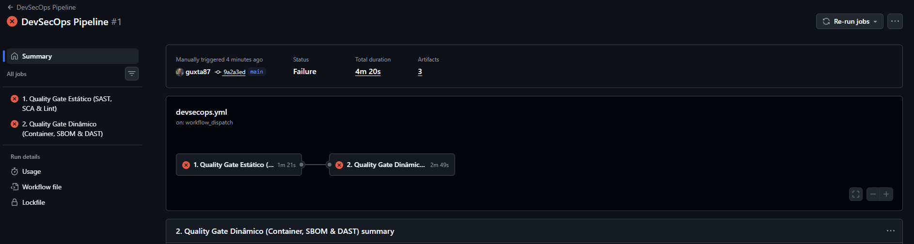

# Relatório de Evidências Técnicas — Clube Aurora (Trilha 3 — Técnica)

**Nome do Aluno:** Gustavo Duarte Lepesteur da Costa

**Turma:** DevSecOps 1746

**Link do Repositório / Fork no GitHub:** <https://github.com/guxta87/devsecops-1746-projeto-final>

**Link do Pull Request Principal:** a preencher após a abertura do PR

---

## 1. Evidência do Pipeline Inicial (Antes das Correções)

**Execução inicial:** <https://github.com/guxta87/devsecops-1746-projeto-final/actions/runs/40803047106>

O pipeline inicial terminou com os dois jobs reprovados:

- **Quality Gate Estático:** falhas no Hadolint, Gitleaks, Trivy Filesystem, Semgrep SAST e análise de IaC do Docker Compose.
- **Quality Gate Dinâmico:** falhas no Trivy Image e OWASP ZAP Baseline.

## 2. Resumo das Correções Implementadas

| Achado | Arquivo modificado | Resumo da alteração realizada |
|---|---|---|
| **F1: Segredos** | `.gitignore`, `.env`, `.env.example` | Remoção do `.env` versionado, inclusão da regra de exclusão e criação de um modelo sem credenciais reais. |
| **F2: SCA** | `requirements.txt` | Atualização de Flask, Werkzeug, Gunicorn e urllib3 para versões estáveis sem as CVEs identificadas pelo Trivy. |
| **F3: SAST** | `app/db.py`, `tests/test_smoke.py` | Substituição da interpolação de texto por consulta parametrizada com `?` e inclusão de teste de regressão contra SQL Injection. |
| **F4: Hardening** | `Dockerfile`, `.dockerignore` | Build multi-stage em Python 3.11 fixado, dependências isoladas, usuário `nonroot`, permissões mínimas, healthcheck e redução do contexto da imagem. |
| **F5: DAST** | `app/__init__.py`, `tests/test_smoke.py` | Inclusão global de CSP, HSTS, `X-Content-Type-Options`, `X-Frame-Options` e `Referrer-Policy`, acompanhada por teste automatizado dos valores esperados. |
| **F6: Menor Privilégio** | `app/db.py`, `app/main.py`, `tests/test_smoke.py` | Papel padrão alterado de `admin` para `client`, rota de mudança de papel restrita a administradores e testes para impedir elevação por usuários `staff`. |
| **F7: IaC** | `docker-compose.yml` | Remoção do modo privilegiado, socket Docker, porta de desenvolvimento e segredos inline; adoção de volume nomeado, filesystem somente leitura, capacidades removidas e `no-new-privileges`. |

## 3. Evidência do Pipeline Final (Após as Correções)

A preencher após a aprovação de todos os Quality Gates.

## 4. Aceitação de Risco

Não prevista. Qualquer exceção necessária será documentada com o respectivo identificador, justificativa e prazo de correção.
