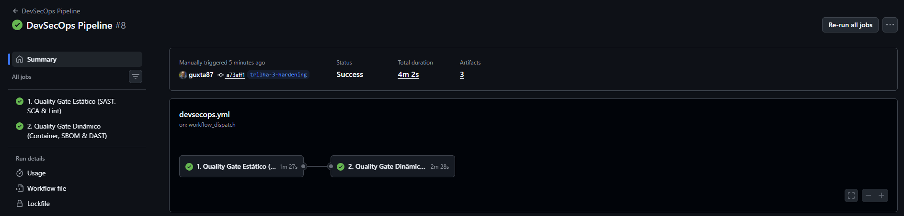
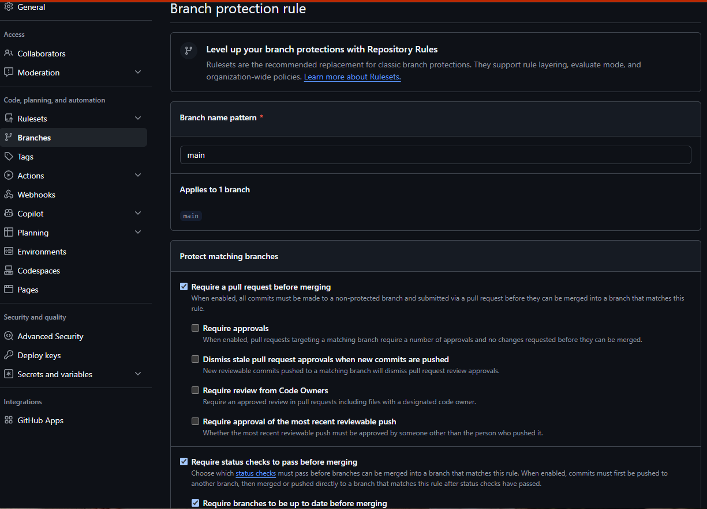
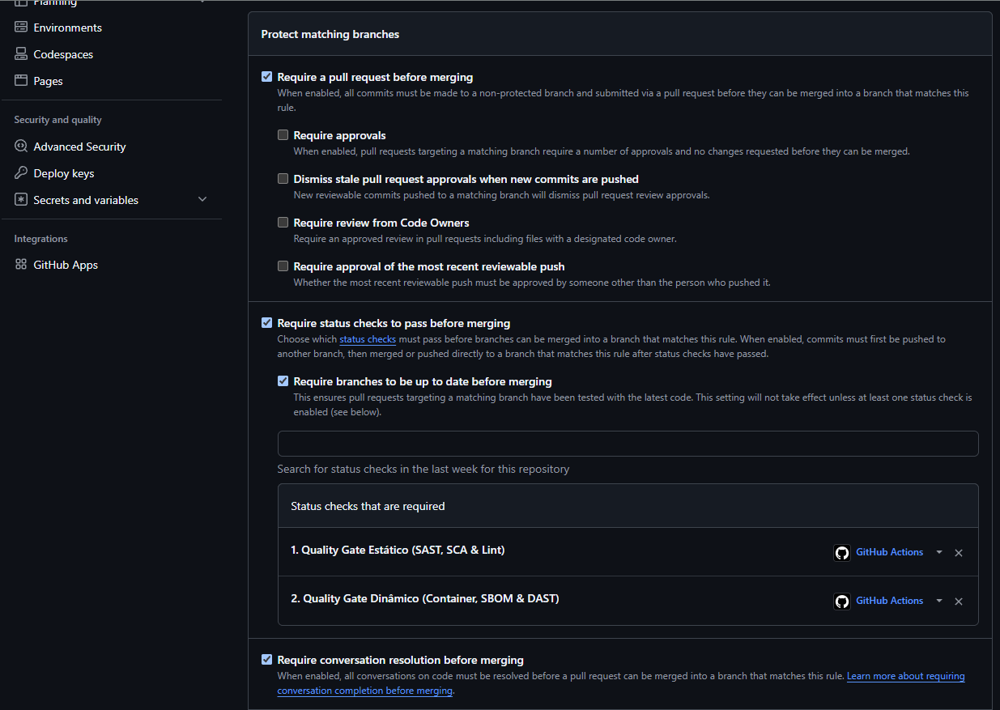

# Relatório de Evidências Técnicas — Clube Aurora (Trilha 3 — Técnica)

**Nome do Aluno:** Gustavo Duarte Lepesteur da Costa

**Turma:** DevSecOps 1746

**Link do Repositório / Fork no GitHub:** <https://github.com/guxta87/devsecops-1746-projeto-final>

**Link do Pull Request Principal:** <https://github.com/guxta87/devsecops-1746-projeto-final/pull/1>

---

## 1. Evidência do Pipeline Inicial (Antes das Correções)

**Execução inicial:** <https://github.com/guxta87/devsecops-1746-projeto-final/actions/runs/40803047106>

O pipeline inicial terminou com os dois jobs reprovados:

- **Quality Gate Estático:** falhas no Hadolint, Gitleaks, Trivy Filesystem, Semgrep SAST e análise de IaC do Docker Compose.
- **Quality Gate Dinâmico:** falhas no Trivy Image e OWASP ZAP Baseline.

## 2. Resumo das Correções Implementadas

| Achado | Arquivo modificado | Resumo da alteração realizada |
|---|---|---|
| **F1: Segredos** | `.gitignore`, `.env`, `.env.example` | Remoção do `.env` da versão atual, inclusão da regra de exclusão e criação de um modelo sem credenciais reais. Como o segredo já havia sido enviado ao Git, a correção no código não o revoga: as credenciais expostas também devem ser trocadas pelo responsável. |
| **F2: SCA** | `requirements.txt` | Atualização conjunta de Flask, Werkzeug, Gunicorn e urllib3 para versões compatíveis e sem as CVEs identificadas pelo Trivy, seguida pelos testes da aplicação. |
| **F3: SAST** | `app/db.py`, `tests/test_smoke.py` | Substituição da interpolação de texto por consulta parametrizada com `?`, fazendo a entrada ser tratada como valor em vez de comando SQL, e inclusão de teste de regressão. |
| **F4: Hardening** | `Dockerfile`, `.dockerignore` | Build multi-stage em Python 3.11 fixado, dependências isoladas, usuário `nonroot`, permissões mínimas, healthcheck e redução do contexto da imagem. Isso limita o impacto de uma invasão e evita manter no runtime ferramentas e bibliotecas desnecessárias. |
| **F5: DAST** | `app/__init__.py`, `.zap/rules.tsv`, `tests/test_smoke.py` | Inclusão global de CSP, HSTS, `X-Content-Type-Options`, `X-Frame-Options`, políticas de origem/permissões e `Cache-Control: no-store`, criando defesa também no navegador. Foram ignorados apenas os alertas informativos sobre o bloqueio intencional de cache e sobre `Sec-Fetch-Dest`, que é um cabeçalho de requisição enviado pelo navegador e ausente no próprio scanner ZAP. |
| **F6: Menor Privilégio** | `app/db.py`, `app/main.py`, `tests/test_smoke.py` | Papel padrão alterado de `admin` para `client`, rota de mudança de papel restrita a administradores e testes para impedir elevação por usuários `staff`. Assim, cada pessoa recebe somente o acesso necessário às suas atribuições. |
| **F7: IaC** | `docker-compose.yml` | Remoção do modo privilegiado, socket Docker, porta de desenvolvimento e segredos inline; adoção de volume nomeado, filesystem somente leitura, capacidades removidas e `no-new-privileges`. O socket foi removido porque acesso de escrita ao daemon poderia permitir controle do host e quebra do isolamento entre contêineres. |

### 2.1 Diagnóstico, classificação e impacto no negócio

| Falha | Causa-raiz e ferramenta | STRIDE / CIA | Impacto para o Clube Aurora |
|---|---|---|---|
| **F1** | Credenciais reais mantidas em `.env` versionado; detectadas pelo Gitleaks (CWE-798). | Divulgação de Informação; Confidencialidade e Integridade. | Permite falsificação de tokens e acesso indevido aos dados de clientes VIP, com risco de incidente sujeito à LGPD, extorsão e dano reputacional. |
| **F2** | Bibliotecas antigas com CVEs conhecidas; detectadas pelo Trivy FS/SCA (CWE-1104). | Adulteração e Elevação de Privilégio; C/I/A. | Uma exploração em dependência exposta pode comprometer o serviço, alterar reservas ou causar indisponibilidade operacional. |
| **F3** | Entrada do usuário interpolada diretamente em SQL; detectada pelo Semgrep (CWE-89). | Adulteração, Divulgação e Elevação; C/I/A. | Um atacante poderia consultar ou modificar a base de clientes e reservas, expondo endereços, roteiros e valores de alto patrimônio. |
| **F4** | Imagem mutável, execução privilegiada e artefatos de build no runtime; Hadolint e Trivy Image (CWE-250). | Elevação de Privilégio; C/I/A. | A exploração da aplicação teria maior impacto dentro do contêiner e poderia facilitar persistência, movimentação lateral e interrupção do serviço. |
| **F5** | Respostas HTTP sem políticas defensivas; detectada pelo OWASP ZAP (CWE-693). | Falsificação, Adulteração e Divulgação; Confidencialidade e Integridade. | Clickjacking, MIME sniffing e injeção de conteúdo poderiam induzir operações fraudulentas ou expor informações da sessão. |
| **F6** | Novos usuários recebiam `admin` por padrão e a rota de papéis exigia apenas login (CWE-284). | Elevação, Adulteração e Repúdio; C/I/A. | Um funcionário comum poderia promover contas, manipular acessos e enfraquecer a responsabilização das ações administrativas. |
| **F7** | Compose com `privileged`, socket Docker e segredo inline; detectada pelo Semgrep IaC (CWE-250). | Elevação e Adulteração; C/I/A. | O comprometimento do serviço poderia evoluir para controle do host Docker, afetando outros sistemas e dados corporativos. |

### 2.2 Governança, RBAC e Segregação de Funções

O pedido de conceder acesso administrativo irrestrito à gerente Carla ou a outro usuário operacional deve ser recusado. O princípio do menor privilégio determina que cada pessoa receba somente as permissões necessárias para suas atividades, e a Segregação de Funções (SoD) evita que uma única conta solicite, aprove e execute alterações sensíveis sem controle independente.

A implementação passou a adotar `client` como papel padrão, mantém `staff` para a operação cotidiana e reserva `admin` às atividades de administração. A mudança de papéis exige `@auth.require_role("admin")`, retorna HTTP 403 para usuários sem autorização e registra a ação no log de auditoria. Em uma evolução futura, um papel intermediário como `concierge_lead` poderia aprovar operações de negócio sem receber acesso à gestão de identidades, logs ou configurações.

### 2.3 Validações e histórico de engenharia

- `pytest`: 10 testes aprovados, incluindo regressões de SQL Injection, headers HTTP, papel padrão e bloqueio de elevação por `staff`.
- `selfcheck --trilha 3`: 7 de 7 verificações aprovadas.
- Scanners locais: Hadolint, Gitleaks, Trivy FS, Semgrep SAST e Semgrep IaC sem achados bloqueantes.
- Trivy Image local no gate ampliado: `Total: 0 (MEDIUM: 0, HIGH: 0, CRITICAL: 0)`.
- Contêiner validado com HTTP 200 e processo `uid=10001(nonroot)`.
- Histórico organizado em commits convencionais e pequenos blocos de correção: evidência inicial, F1, F2, F3, F4, segurança da aplicação (F5/F6), F7 e documentação de risco/DAST.

## 3. Evidência do Pipeline Final (Após as Correções)

**Execução aprovada do Pull Request:** <https://github.com/guxta87/devsecops-1746-projeto-final/actions/runs/40806356959>

**Execução manual aprovada com Quality Gate `MEDIUM,HIGH,CRITICAL`:** <https://github.com/guxta87/devsecops-1746-projeto-final/actions/runs/40806760676>

Na execução ampliada, os dois jobs foram aprovados:

- **Quality Gate Estático:** Hadolint, Gitleaks, Trivy Filesystem, Semgrep SAST e Semgrep IaC aprovados.
- **Quality Gate Dinâmico:** build, Trivy Image, geração de SBOM, healthcheck e OWASP ZAP Baseline aprovados.

O workflow oficial agrupa os controles em dois jobs principais. Dentro deles são executadas todas as etapas exigidas: SAST, SCA, lint, análise de IaC, imagem do contêiner, SBOM e DAST.

## 4. Aceitação e Governança de Risco

O arquivo `.trivyignore` foi incluído para atender ao processo formal de gestão de exceções, mas não contém nenhuma CVE suprimida. Todos os achados detectados nos gates adotados foram corrigidos; portanto, não há aceitação de risco ativa.

Uma exceção temporária somente seria justificável quando o risco residual fosse controlado e não houvesse correção imediata disponível, por exemplo enquanto se aguarda uma atualização do fornecedor. Mesmo nesse caso, ela deveria registrar justificativa, controles compensatórios, responsável e prazo de revisão. Um ambiente controlado reduz a probabilidade de exploração, mas não elimina a necessidade de acompanhamento posterior.

## 5. Bônus — Proteção da Branch `main`

A branch `main` do fork foi protegida para exigir Pull Request, exigir que a branch esteja atualizada antes da integração, aguardar os dois Quality Gates e exigir a resolução das conversas. Force push e exclusão da branch permanecem bloqueados.

